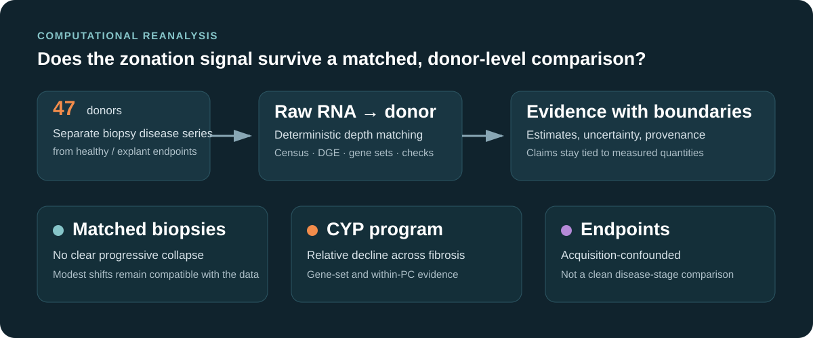

<div align="center">

# Liver Zonation: A Computational Reanalysis

**A Python/R workflow for testing whether a reported liver-zonation signal survives donor-level, acquisition-matched analysis.**

[Evidence](EVIDENCE.md) · [Technical report](reports/Report_complete.pdf) · [Reproduce](REPRODUCING.md)

</div>



## The question

Hepatocytes normally express different programs near the portal tract and central vein. A published single-nucleus study reported that this zonation weakens as chronic liver disease advances. This project asks a narrower question: **does that transcriptional pattern remain after comparing donors sampled in the same way and treating the donor, rather than each nucleus, as the unit of inference?**

The source cohort contains 47 donors and 99,809 nuclei. The disease-stage analysis uses 38 needle-biopsy donors (F0/F1/F2/F3/F4 = 2/8/12/12/4); the healthy and end-stage groups were sampled as organ tissue and are kept separate because disease stage and tissue acquisition are confounded at those endpoints.

## What I built

- A raw-RNA extraction and validation route that distinguishes RNA-assay UMIs from the repository's historical SCT matrix.
- Deterministic, repeated binomial thinning for fair molecule-detection comparisons across nuclei.
- Donor-level zonation measurements, sensitivity analyses, differential expression, gene-set tests, and confound checks across Python and R.
- A clean runner that writes into a fresh output directory, records input hashes and commands, and rejects stale outputs.
- A technical report and evidence map that connect the biological question to the computational decisions, results, and limitations.

I developed the analysis workflow, carried out the reanalysis, and wrote the report and presentation. The project uses public data and established statistical methods from the cited studies and software packages.

## What the analysis found

### 1. No clear progressive collapse in the matched-biopsy measurements

Pericentral, periportal, strict co-expression, and double-negative measurements are flat or non-monotone across biopsy fibrosis stages. The F1-to-F4 pericentral-fraction difference is **+3.45 percentage points** (90% CI **−13.63 to +20.54**). The pre-specified ±5 and ±10 point equivalence margins are **not** established, so the data do not rule out a modest shift.

These are separate detection metrics, not a four-way partition: permissive PC/PP gates and the stricter co-expression gate leave a **weak-dual remainder of 9.41%** of retained biopsy nuclei. The public tables now show that remainder explicitly.

### 2. A relative CYP detoxification program declines

The 13-gene CYP set trends downward in both a competitive test (CAMERA FDR **2.32×10⁻⁶**) and a self-contained rotation test (mROAST FDR **0.015**). A separate five-gene, within-pericentral measure falls from **11.86 to 9.02 UMIs per nucleus** from F1 to F4; the donor-level fibrosis trend is **Spearman ρ = −0.461, p = 0.004**.

This is a relative RNA-program measurement under a fixed sequencing budget. It does not establish absolute loss of detoxification capacity, spatial reorganization, or a causal mechanism. The 13-gene set and five-gene per-cell measure are related checks, not identical replications.

### 3. Endpoint comparisons are acquisition-confounded

Healthy and end-stage samples were acquired differently from the needle-biopsy disease series. The endpoint groups also carry a broad stress signature across cell lineages. This makes the pooled healthy-to-end-stage trajectory unsuitable for isolating a disease-stage effect from tissue procurement.

The analysis re-examines the single-nucleus transcriptional evidence only. It does not reassess the original paper's imaging, protein, organoid, or functional experiments.

## Explore the evidence

| Route | Best for | Contents |
|---|---|---|
| [Evidence map](EVIDENCE.md) | Fast technical review | Claim → cohort → estimate → source table/script → limitation |
| [Technical report](reports/Report_complete.pdf) | Research readers | Full methods, interpretation, figures, and limitations |
| [Analysis code](src/README.md) | Engineering review | Script map across extraction, census, confounds, DGE, and plotting |
| [Committed result tables](results/tables/analysis/) | Direct inspection | Donor summaries, intervals, DGE, and gene-set outputs |

`FINDINGS.md` and `CLAIMS_LEDGER.md` preserve the project's investigation history. Use [EVIDENCE.md](EVIDENCE.md) for the current public claim set.

## Reproduce the verified route

The committed result tables can be inspected without downloading the multi-gigabyte input. To rerun the bounded headline route after preparing the data:

```bash
python scripts/run_verified.py \
  --data-root /path/to/liver-zonation-data \
  --output-root /path/to/new-empty-output
```

The runner validates the raw-count extraction, rebuilds the donor metrics, precision/equivalence table, genome-wide screens, Plan A model, CAMERA/mROAST checks, and within-PC measure. It writes logs and a hash manifest to the new output directory. See [REPRODUCING.md](REPRODUCING.md) for data preparation, tested versions, and the distinction between a results rerun and extraction from the original Seurat object.

## Scope

- **Measured:** transcriptional programs and donor-level cell-state proportions in single-nucleus RNA data.
- **Not measured:** lobular geometry, protein abundance, enzyme activity, or causal effects of tissue handling.
- **Main constraint:** only four F4 biopsy donors; confidence intervals remain wide.
- **Interpretive boundary:** absence of a clear trend in these measurements is not proof that spatial zonation is unchanged.

## Data and credit

Data: Gribben *et al.*, “Acquisition of epithelial plasticity in human chronic liver disease,” *Nature* 630, 166–173 (2024), [GSE202379](https://www.ncbi.nlm.nih.gov/geo/query/acc.cgi?acc=GSE202379). Raw data are not committed; follow the source repository and GEO terms when downloading and using them.

Analysis and writing: **Roee Tekoah**. Third-party methods and software are credited in the report and source comments. Code and original project material are released under the repository's [CC BY 4.0 license](LICENSE).
